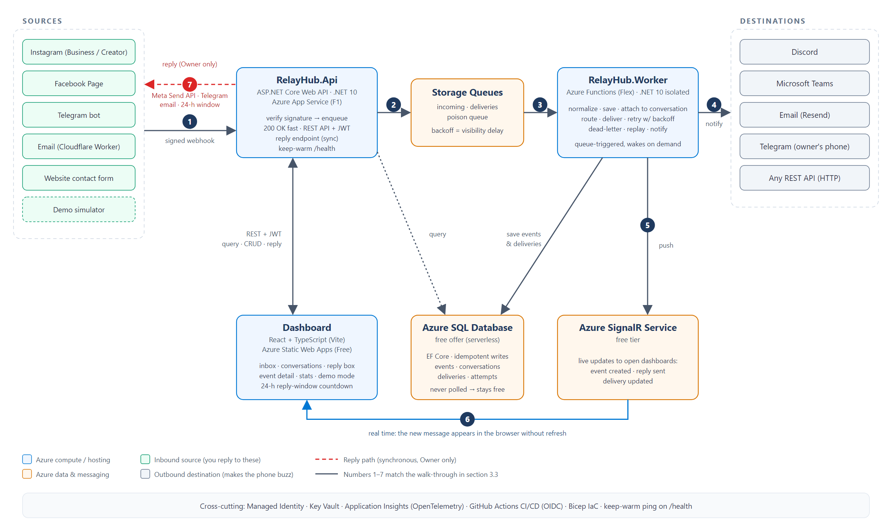

# RelayHub

**Unified customer inbox for small businesses, built on a reliable integration hub.**

Messages from Instagram, a Facebook Page, the website contact form, email and Telegram arrive in one web dashboard, and you reply from that same screen. Under the hood: a queue-first event pipeline on Azure with signed webhooks, retries with exponential backoff, dead-lettering, one-click replay, live updates and end-to-end tracing. Nothing gets lost.

> **Live demo:** dashboard URL in the repo's About box (Azure Static Web Apps) · API docs: https://app-relayhub-prod-api-s4w2qp.azurewebsites.net/docs
> One click "Try the live demo", no sign-up: a sandbox workspace with sample conversations, "simulate a message" buttons for every channel, a failure switch that shows retries → dead-letter → replay, and a reply box with the Meta 24-hour window. Nothing in the demo touches a real channel.



## What it does

| Area | Details |
|---|---|
| **Channels in** | Website form (signed API key), Facebook Page + Instagram (Meta webhooks, `X-Hub-Signature-256`), Telegram bot (secret token), inbound email (Cloudflare Email Routing → Worker → signed POST) |
| **Replies out** | From the conversation screen, on the original channel: Meta Send API (24-hour window enforced, clear 409 when closed), Telegram bot, Resend email (also for website-form leads) |
| **Notifications** | Routes with templates (`{{name}} {{text}} {{channel}} …`) to Discord, Microsoft Teams (Workflows webhook), email (Resend), Telegram, or any HTTPS endpoint (SSRF-guarded, owner only) |
| **Reliability** | Queue-first ingest (verify + enqueue, 202 in milliseconds, no SQL on the hot path), at-least-once processing made safe by idempotency keys, one queue message = one attempt, backoff 30 s → 2 min → 10 min → 30 min → 1 h, dead-letter after 5, replay keeps the attempt history, operator alert on dead-letter / poison |
| **Dashboard** | Landing, wake-up screen for cold starts, inbox with filters and live updates (Azure SignalR), conversations with reply box and countdown, event detail with raw payload and delivery timeline + Replay, stats (today, success rate, 7-day series), settings for sources / destinations / routes with "send test" |
| **Security** | JWT (Owner / Demo roles), every query workspace-scoped by an EF Core global filter, stateless HMAC-signed source keys, constant-time signature checks, secrets in Key Vault, managed identities for Storage / Key Vault / SignalR, OIDC deploys (no Azure secrets in GitHub), per-IP rate limits, masked configs in every response |
| **Observability** | OpenTelemetry → Application Insights in API and worker; the W3C trace context rides in every queue message, so API → queue → worker → connector is one trace; `X-Correlation-Id` on every response |

## Stack

C# / .NET 10 · ASP.NET Core minimal APIs · EF Core 10 · Azure Functions (isolated, Flex Consumption) · Azure SQL (free offer, serverless) · Azure Storage Queues · Azure SignalR Service (serverless) · Azure Static Web Apps · Key Vault · Application Insights · React 19 + TypeScript (Vite) · GitHub Actions (OIDC) · Bicep

## Repository layout

```
src/RelayHub.Api             ASP.NET Core Web API: webhooks (verify + enqueue), REST API + auth, replies, realtime negotiate, demo endpoints, OpenAPI docs (/docs)
src/RelayHub.Worker          Azure Functions worker: incoming → parse/store/route, deliveries → send/retry/dead-letter, poison alerts
src/RelayHub.Core            domain model, queue message contracts, templates, signatures, connector / reply / parser interfaces, demo catalog
src/RelayHub.Infrastructure  EF Core + migrations, Storage Queues, parsers (Meta, Telegram, email, generic), connectors, reply channels, SignalR notifier, dispatcher, processors
web/                         React + TypeScript dashboard (Vite), deployed to Azure Static Web Apps
tests/                       xUnit unit tests; integration tests (WebApplicationFactory + Testcontainers SQL Server, real processors, faked outbound HTTP)
infra/                       Bicep for every Azure resource (all free tiers) + Cloudflare Email Worker; bootstrap script
.github/workflows            CI (unit + Docker tests, dashboard build), deploy (Bicep → migrations → worker → API → dashboard), keep-warm ping, diagnose
docs/                        plan, architecture diagram, clickable mockup, HANDOFF.md (status + build journal)
```

## How a message flows

1. A customer DMs the studio's Instagram. Meta POSTs to `/api/v1/hooks/meta`; the API checks the signature, drops the raw payload on the `incoming` queue and answers 200 in milliseconds.
2. The worker parses it, stores the event (duplicates ignored), attaches it to the customer's conversation, creates one delivery per route and queues each.
3. Each delivery runs through its connector; failures retry with backoff and dead-letter after five attempts, which pings the operator on Discord.
4. The dashboard receives `eventCreated` / `deliveryUpdated` over SignalR — no refresh, no polling (serverless SQL must be allowed to sleep).
5. The owner replies from the conversation screen; the API calls the Meta Send API synchronously and stores the outbound message, or explains why the 24-hour window is closed.

## Run locally

Prerequisites: .NET 10 SDK, Node 20+, Docker (for SQL Server, Azurite and the Testcontainers tests), Azure Functions Core Tools 4.16+.

```bash
docker run -d --name relayhub-sql -e ACCEPT_EULA=Y -e MSSQL_SA_PASSWORD='<strong pw>' -p 1433:1433 mcr.microsoft.com/mssql/server:2022-latest
docker run -d --name relayhub-azurite -p 10000-10002:10000-10002 mcr.microsoft.com/azure-storage/azurite

cd src/RelayHub.Api
dotnet user-secrets set "ConnectionStrings:RelayHub" "Server=localhost,1433;Database=RelayHub;User Id=sa;Password=<strong pw>;TrustServerCertificate=True"
dotnet user-secrets set "RelayHub:ApiKeyMasterKey" "<long random string>"
dotnet user-secrets set "RelayHub:MigrateOnStartup" "true"
dotnet user-secrets set "RelayHub:SeedOnStartup" "true"
cd ../..

dotnet run --project src/RelayHub.Api --urls http://localhost:5080     # docs at http://localhost:5080/docs
cd src/RelayHub.Worker && cp local.settings.sample.json local.settings.json && func start   # fill in the SQL connection string first
cd web && npm install && npm run dev                                    # http://localhost:5173, talks to the API on 5080
```

Development sign-in: `owner@relayhub.local` / `relayhub-dev-owner` (Studio workspace), or "Try the live demo" for the Demo workspace. The seeder creates both workspaces, the `website-contact` source (its API key is logged on startup) and the demo sample data. `scripts/smoke.sh` walks the whole flow with curl.

Optional local settings (user-secrets or `appsettings.Development.json`): `RelayHub:Meta:AppSecret` + `VerifyToken`, `RelayHub:Telegram:WebhookSecret`, `RelayHub:Email:InboundSecret`, `RelayHub:Resend:ApiKey` + `From`, `SignalR:ConnectionString`, `RelayHub:Turnstile:Secret`. Unset features answer a clear Problem Details (`503 channel not configured`, `503 realtime-unavailable`) instead of failing.

### Tests

```bash
dotnet test RelayHub.slnx --filter "Category!=Docker"   # unit + in-process API tests
dotnet test RelayHub.slnx                                # also the Docker tests: real processors against SQL Server in Testcontainers
cd web && npm test                                       # Vitest
```

The Docker tests drive the actual pipeline: signed webhooks → queue → parsers → store → deliveries → connector (faked) with retries, dead-letter, replay, the demo failure switch, auth and workspace isolation.

## Azure

Everything is Bicep (`infra/main.bicep`) and stays on free tiers: App Service F1 (API), Functions Flex Consumption (worker), Azure SQL free offer, Storage Queues, Key Vault, Application Insights, SignalR Free, Static Web Apps Free. GitHub Actions deploys with OIDC: Bicep → EF migration bundle → worker → API → dashboard, then smoke checks. `infra/README.md` lists the GitHub secrets (required: `JWT_SIGNING_KEY`, `OWNER_EMAIL`, `OWNER_PASSWORD`; the channel secrets are optional). A keep-warm cron hits `/health` (never the database) during Mountain-time daytime so visitors rarely see a cold start.

## Decisions worth asking about

Queue-first ingest · Storage Queues over Service Bus · at-least-once + idempotency · backoff by visibility delay · Functions instead of in-process background jobs on F1 · stateless signed API keys · managed identity everywhere · never poll serverless SQL · separate demo workspace with mocked destinations · borrowed push notifications (Discord / Telegram) instead of a mobile app · synchronous replies vs asynchronous deliveries. Each one with its trade-off is in `docs/plan-src/plan.md` section 5.2 and `CLAUDE.md`; the real bugs met along the way are in the build journal in `docs/HANDOFF.md`.

## Roadmap

| Week | Deliverable | Status |
|---|---|---|
| 1 | Core API, EF Core + SQL, generic ingest, Discord connector, OpenAPI, deploy | done |
| 2 | Storage Queues + Functions worker, retries / backoff, dead-letter, replay, Key Vault, tracing | done |
| 3 | React dashboard: inbox, conversations, event timeline, stats, SignalR live updates, JWT auth | done |
| 4 | Facebook Page + Instagram (inbound + reply), Telegram, inbound email, Teams / email / Telegram / HTTP connectors | done (code); connecting the studio's real accounts is a manual step |
| 5 | Public demo workspace with simulators, failure switch, rate limits, keep-warm, Docker tests in CI | done |
| 6 | README, demo GIF, real usage for the studio, resume | in progress |
| later | Meta App Review (so strangers' DMs arrive), WhatsApp, Entra-only SQL auth, Graph profile lookup for Meta senders | — |
